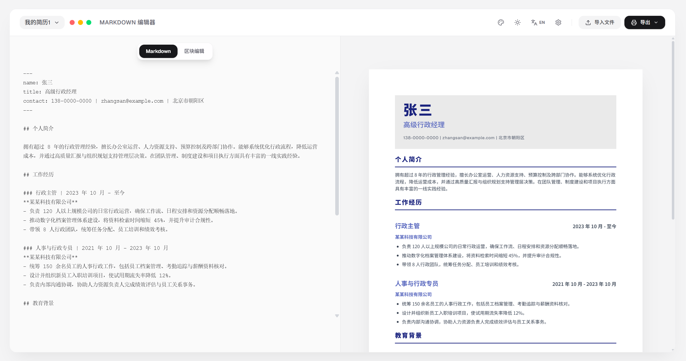

# openResume

An open-source AI resume builder and Markdown resume editor with local-first storage, block editing, A4 live preview, resume import, and export to PDF / DOCX / HTML.

openResume helps developers, designers, product managers, and job seekers keep resume content editable over time, preview final A4 output while writing, protect private resume data, and iterate faster with AI assistance.

[中文](./README.md) | [English](./README.en.md)

Live Demo: [https://open-resume-dun.vercel.app/](https://open-resume-dun.vercel.app/)

GitHub: [https://github.com/jonbrown66/openResume](https://github.com/jonbrown66/openResume)

[](https://github.com/jonbrown66/openResume/blob/main/LICENSE)
[](https://github.com/jonbrown66/openResume/actions/workflows/ci.yml)
[](https://nextjs.org)
[](https://react.dev)
[](https://www.typescriptlang.org/)



## Features

- Dual editing modes: Markdown and block editor
- Paginated A4 preview with Markdown and block editing
- Zoomable preview with template switching and style controls (Geist is bundled locally; other font choices use installed fonts and system fallbacks)
- Import support for `md / txt / pdf / docx`
- Local fallback parsing when no API key is configured
- AI-assisted resume editing with before/after diff preview
- Project-scoped assistant memory with a default limit of 20 recent messages
- Export to `PDF / DOCX / HTML`
- Local multi-project resume management with optimized mobile layout and UI details
- Support for OpenAI, Anthropic, Gemini, DeepSeek, and OpenRouter (supports custom models and connectivity test)

## Tech Stack

- Next.js 15
- React 19
- TypeScript
- Tailwind CSS 4
- Framer Motion
- Vitest
- `pdfjs-dist`
- `mammoth`
- `docx`
- Playwright / Chromium

## Local Development

Recommended with `pnpm`:

```bash
pnpm install
pnpm dev
```

Or with `npm`:

```bash
npm install
npm run dev
```

Open: [http://localhost:3000](http://localhost:3000)

## Test and Build

```bash
pnpm test
pnpm build
pnpm start
```

Or:

```bash
npm test
npm run build
npm run start
```

## AI Configuration

AI settings are managed from the in-app settings panel and stored in browser local storage.

Supported providers:

- OpenAI
- Anthropic
- Gemini
- DeepSeek
- OpenRouter

Configurable fields:

- Active provider
- API key
- Base URL
- Default model
- Custom model

Notes:

- Import first tries AI formatting and falls back to local parsing when needed
- The assistant includes a model connectivity test
- Missing API keys or models are surfaced with explicit UI messages

## Export

- PDF: generated through the server-side export pipeline
- Word: generated with `docx`
- HTML: exports the current resume page as HTML

Export endpoints:

- `app/api/export/pdf`
- `app/api/export/docx`
- `app/api/export/html`

## Project Structure

```text
app/                         Next.js App Router and export APIs
src/components/              page, editor, preview, and assistant components
src/components/assistant/    assistant subcomponents
src/components/settings/     settings panels
src/components/ui/           shared UI components
src/config/                  UI copy and default config
src/config/translations/     localized copy
src/hooks/                   custom hooks
src/lib/                     runtime utilities
src/test/                    tests
src/types/                   type definitions
src/utils/                   resume parsing, AI, import, and export utilities
```

## Product Direction

`openResume` is not just a Markdown-to-PDF converter. It is a local resume workspace designed for continuous editing and iteration. The current focus is:

- keeping resume content editable over time
- keeping preview output close to the final export result
- leaving clean extension points for future templates, themes, and richer block editing

## Notes

- The first PDF export can be slower while browser-side dependencies initialize
- Scanned PDFs may still have limited text extraction quality
- Assistant changes are applied only after a manual confirmation click

## Validation and privacy boundaries

Run `pnpm lint`, `pnpm typecheck`, and `pnpm test`. `pnpm test:e2e` builds the app and runs Playwright in isolated desktop and mobile viewport contexts with synthetic resumes and mocked AI responses. Install Chromium with `pnpm exec playwright install chromium`, or set `PLAYWRIGHT_EXECUTABLE_PATH`. Failed runs retain screenshots and traces; CI uploads the report.

Development uses `.next-dev` and production uses `.next`, so a build cannot overwrite a running development server's assets. With `pnpm dev` already running at `http://localhost:3000`, run `pnpm exec playwright test --config=playwright.dev.config.ts` to check development behavior, including runtime and hydration errors.

API keys are stored in plaintext LocalStorage on the current browser. Editing, file extraction, and HTML downloads are local; PDF/DOCX send resume data to the application server. AI sends text directly to the configured provider. Geist is bundled locally; other font choices use installed system fonts and fallbacks. DOCX uses editable Word layout and does not reproduce arbitrary custom CSS. Empty imports preserve the existing resume. Damaged project storage is backed up under `resume_projects-recovery-*`.
